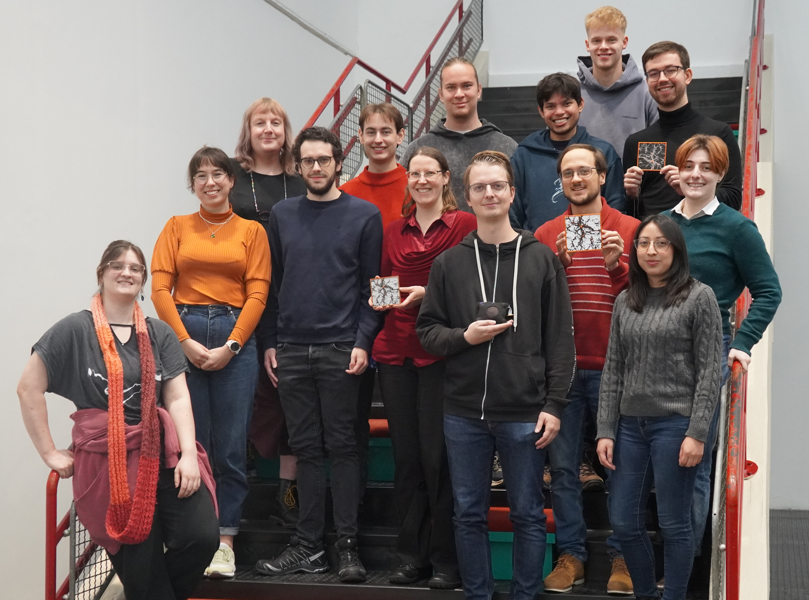
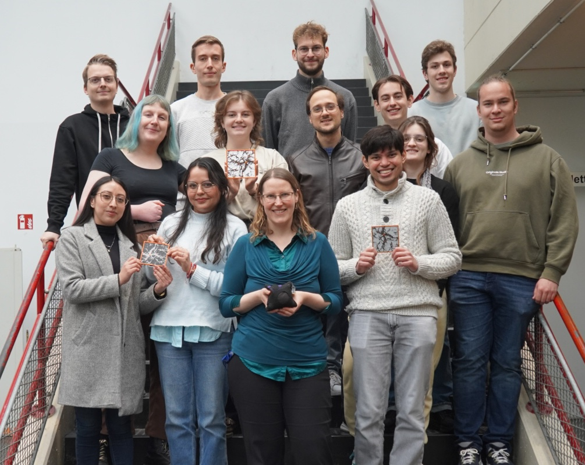
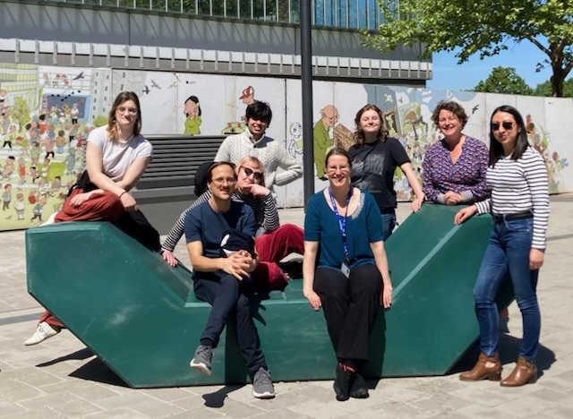

# Cora Uhlemann

Professor in Cosmology at Bielefeld University, Visiting Professor at Newcastle University

## Navigation

- [Home](index.md)
- [CV](CV.md)
- [EDI](edi.md)
- [JOBS](jobs.md)
- [OUTREACH](outreach.md)
- [PUBLICATIONS](publications.md)
- [RESEARCH](research.md)
- [TALKS & MEETINGS](talks.md)
- [TEACHING & SUPERVISION](teaching.md)

## About Me

Since March 2024, I am a **Professor in Cosmology** at **Bielefeld University** where I took up my ERC Starting Grant 2022 (worth ~1.5 million EUR) on “Probing cosmic large-scale structure beyond the average”. Two postdocs started late 2024/early 2025 and a PhD student will start in autumn 2025. I am a [Henriette Herz Scout](https://www.humboldt-foundation.de/en/apply/sponsorship-programmes/henriette-herz-scouting-programme) for the Humboldt Foundation, so if you are interested in being hosted in my group in Bielefeld for a [Humboldt Research Fellowship](https://www.humboldt-foundation.de/en/apply/sponsorship-programmes/humboldt-research-fellowship) and belong to an underrepresented group, please get in touch. I am a PI for the project “Strong-interaction matter in the early universe” in the [Collaborative Research Center TR 211 “Strong-interaction matter under extreme conditions”](https://crc-tr211.org) between Bielefeld, Frankfurt and Gießen. I am coordinator for the [Euclid Consortium](https://www.euclid-ec.org) DR 1 Key Project “Higher-order weak lensing statistics with mass mapping”, previously I was co-leading the Additional Galaxy Clustering Probes work package. I am also active in the [LSST Dark Energy Science Collaboration](https://lsstdesc.org) higher-order statistics topical team and member in the [SKA Observatory Cosmology Working Group](https://www.skao.int/en/science-users/science-working-groups/104/cosmology).

I am a Visiting Professor at Newcastle University. Previously, I was a Reader in Cosmology as part of [Applied Mathematics at Newcastle University](https://www.ncl.ac.uk/maths-physics/research/applied/), deputy lead for our [Theoretical Cosmology](https://blogs.ncl.ac.uk/cosmology/) group, deputy director of the [NUdata STFC Centre for Doctoral Training in Data-Intensive Science for Astrophysics](https://research.northumbria.ac.uk/nudata/) in collaboration with Northumbria University, and member of the [Observational Astronomy](https://blogs.ncl.ac.uk/astro-obs/) research group.

## My large-scale structure research group

- Lennart Mielke (Bachelor student, since October 2026)
- William Erba (CRC TR211-funded PhD student, since October 2026)
- Szymon Juszczak (PhD student, since October 2026)
- Amon Boigs (Master student, since July 2026)
- Nils Mareczek (Bachelor student, since March 2026)
- Aoibhinn Gallagher (independent Humboldt Postdoctoral Fellow, since Feb 2026)
- David Gebauer (ERC-funded PhD student, since Sept 2025)
- Robin Blotevogel (Master student, since Sept 2025)
- [Simon May](https://wwwhomes.uni-bielefeld.de/~smay3/) (independent ERC-preparative Postdoctoral Fellow at Bielefeld University, from Sept 2025)
- Sophie Ashworth (Master student, since April 2025)
- Bernhard Vos Gines (ERC-funded postdoc, since January 2025)
- Ashim Sen Gupta (ERC-funded postdoc, since November 2024)
- Carolyn Mill (PhD student in the STFC CDT NUdata at Newcastle University, since September 2023, in Bielefeld April–Dec 2025)
- Lina Castiblanco Tolosa (STFC + ERC-funded PostDoc, since October 2022)
- [Beth Gould](https://bethgould.net) (PhD student at Newcastle University, Sept 2022-Nov 2026, in Bielefeld April–Dec 2025, from April-Nov 2026)

### Previous members

- Jannis Schrepel (Bachelor student, Sept 2025 - Sept 2026)
- Sofia del Pilar Samario Nava (Visiting PhD student from Mexico, July–November 2025)
- Hannes Steinmeier (Bachelor student, 2025)
- Elias Krolik (Bachelor student, 2025)
- [Alex Gough](https://alexandergough.com/) (PhD student at Newcastle University, September 2020–August 2024)

## Group Picture Winter Semester 26/27

from left to right
-Last row: Lennart Mielke
-Second last row: Robin Blotevogel, Ashim Sen Gupta, Szymon Juszczak 
-Middle row: Beth Gould
-second front row: Aoibhinn Gallagher, Nils Mareczek, Cora Uhlemann, Bernhard Vos Gines, William Erba
-front row: Sophie Ashworth, Simon May, Lina Castiblanco

## Group Picture Winter Semester 25/26

from left to right
- Back row: Simon May, Elias Krolik, Jannis Schrepel, Hannes Steinmeier
- Middle row: Beth Gould, Carolyn Mill, Bernhard Vos Gines, Sophie Ashwort, Robin Blotvogel
- Front row: Lina Castiblanco Tolosa, Sofia del Pilar Samario Nava, Cora Uhlemann, Ashim Sen Gupta

## Picture from our Kick-Off Workshop on May 12, 2025

- Back from left to right: Sophie, Ashim, Carolyn, Helena Ernst (workshop facilitator)
- Front from left to right: Bernhard, Beth, Cora, Lina

Together with Ulrike Böhm, I am running the [facebook page ‘Physikerinnen’ for female physicists](https://www.facebook.com/Physikerinnen/). Every week, we highlight an excellent woman in physics (from student to professor) as ‘female physicist of the week’. I am committed to making a positive contribution to EDI in academia and supportive of underrepresented groups including women, BAME, LGBTQIA+.

If you want to learn more about me and my research, see some interviews and press releases below.

## Media

I am very excited to have been part of the [‘Universe Unravelled’ series](http://www.ctc.cam.ac.uk/news/201113_newsitem.php) filmed at Cambridge that is available on Discovery+, the streaming channel of Discovery Channel UK.

## Interviews and Press Releases

- [Bielefeld University Article on Dual Career (uni-internal)](https://aktuell.uni-bielefeld.de/uniintern/dual-career-ein-doppeltes-willkommen/)
- [Springer Nature Career Guide Germany interview contribution](https://www.nature.com/articles/d41586-025-03778-y)
- [Bielefeld University Video-Interview “Die Forschungslücke” (research gap series, in German)](https://www.linkedin.com/posts/bielefeld-university_wir-schmei%C3%9Fen-daten-weg-bedauert-die-kosmologin-activity-7397256054486753280-Vlwq?utm_source=share&utm_medium=member_desktop&rcm=ACoAABZh3cgB85Ux5HQCGqIZBaVrI0YVYoC-z5c)
- [Perimeter Institute Article about my research and my group](https://perimeterinstitute.ca/news/eyeglasses-space-telescope)
- [Bielefeld University Article about my research and ERC project](https://aktuell.uni-bielefeld.de/2024/03/19/billions-of-galaxies-beyond-the-average-mediocrity/?lang=en)
- [Newcastle University Blog Article about the Launch of the Euclid Mission I am part of](https://from.ncl.ac.uk/euclid-mission-mapping-the-universe?hs_preview=IGGSSwll-125627323681)
- [Newcastle University Press release about the Launch of the Euclid Mission I am part of](https://www.ncl.ac.uk/press/articles/latest/2023/06/euclidmission/)
- [Newcastle International Women’s Day 2022 – Women in STEM](https://www.ncl.ac.uk/nes/news/news-items/iwd-blog/)
- [European Consortium for Astroparticle Theory (EuCAPT) Community Profile](https://www.eucapt.org/post/community-profile-cora-uhlemann)
- [TUMJA Young Academy of Technical University Munich (in German)](https://www.ja.tum.de/ja/wir/08-21-cora-uhlemann/)
- [Lindau Nobel Laureate Meeting Panel Discussion on Women in Science](https://www.mediatheque.lindau-nobel.org/videos/38708/debate)
- [Newcastle Women in STEM page](https://belong.ncl.ac.uk/blog/women-in-stem-faculty-of-science-agriculture-engineerin)
- [Cambridge Women in STEM page](https://www.cam.ac.uk/research/news/women-in-stem-dr-cora-uhlemann)
- [German Youth magazine jetzt.de (in German)](https://www.jetzt.de/job/wie-viel-verdient-eine-physikerin7)
- [Women in Research Blog](https://womeninresearchblog.wordpress.com/2016/06/13/cora-germany/)
- [Fitzwilliam College Cambridge Magazine Optima](https://issuu.com/fitzwilliamcollegecomms/docs/optima_24_web/26)

## Contact

### Bielefeld University

- [cora.uhlemann@uni-bielefeld.de](mailto:cora.uhlemann@uni-bielefeld.de)
