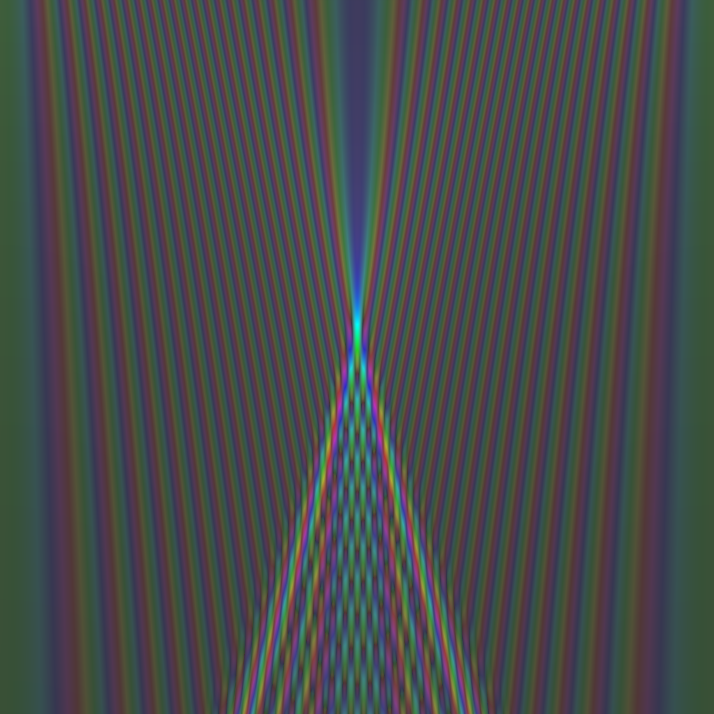
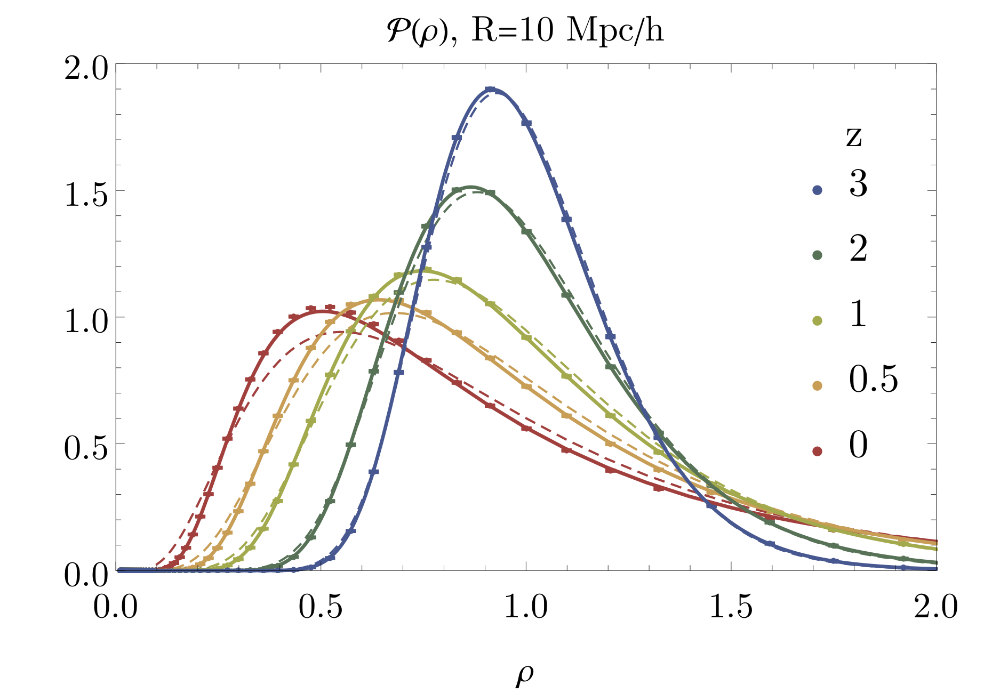

# Research

## Research Interests: Theoretical Cosmology, Astrophysics & Gravitation

### Large scale structure
cosmic web, matter and halo correlation functions, redshift space distortions

### Dark matter dynamics and self-gravitating systems
perturbation theory, spherical collapse, semiclassical methods for classical dynamics, Vlasov-Poisson and Schrödinger-Poisson equations

*Collapse in 1+1dimensional phase space showing the transition from a flat phase space sheet to a bound dark matter structure modelled by solving the Schrödinger-Poisson equation (blue contours) and the Zeldovich approximation (red dashed line)*

*Time-evolution of a wave function solving the free Schrödinger equation in 1D. This is a semiclassical analogue of the Zeldovich approximation. Shell-crossing forms multiple streams that manifest as interference patterns.*

### Large Deviation Statistics
theory of large deviations from statistical mechanics and it’s application in cosmology

### Beyond the standard model of cosmology
including the primordial universe, dark matter, dark energy and modified gravity

### Cosmological Perturbation Theory
stability analysis, primordial anisotropy

## Contact

### Bielefeld University

- [cora.uhlemann@uni-bielefeld.de](mailto:cora.uhlemann@uni-bielefeld.de)
